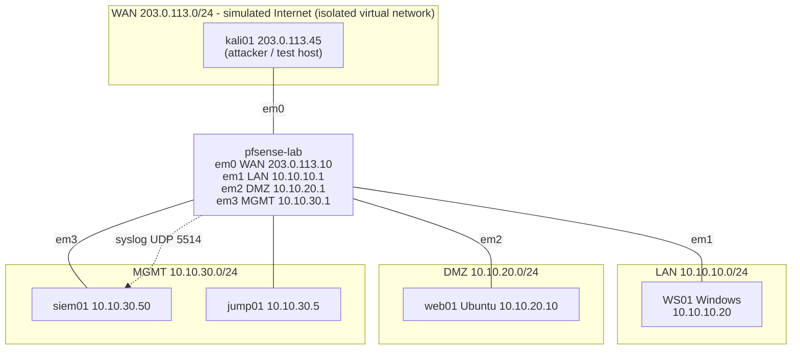

# pfSense Network Security Monitoring Lab

[](https://github.com/OYDeadpoolife/pfsense-network-security-lab/actions/workflows/ci.yml)

A documented design for a **safe, isolated virtual network security lab** built around a pfSense firewall: WAN, LAN, DMZ and management zones,
NAT and VLAN configuration, firewall rules with allowed-versus-blocked behaviour, remote syslog to a SIEM and a Wireshark workflow.
It ships a **synthetic** firewall log and packet capture, a log-analysis script and a connectivity-test script, so you can practise reading
firewall events even before you have built the virtual machines.

> **Read this first — what is verified and what is not.**
> * **No pfSense virtual machine was built or configured for this repository.** The step-by-step guide, rule tables, NAT, VLAN and syslog
>   settings are a *design and instructions*; they have **not** been confirmed on a running pfSense. Menu names and behaviour are taken from the
>   official Netgate documentation where noted, and otherwise from general knowledge, so check them against your pfSense version.
> * **The firewall log and the packet capture are synthetic** (constructed by scripts that follow the documented formats). They are not captures of real traffic.
> * **Verified (executed, tests pass):** the generators, the log-analysis script, the connectivity-test script (against a local listener), the
>   packet-capture file format (checksums verified with `tcpdump`), and the consistency of the documents. See [TEST_RESULTS.md](TEST_RESULTS.md).
> * Two paths are offered: a **documentation-only path** (works now) and a **VM-based path** (needs your virtual machines; its results are
>   recorded by you in [TEST_RESULTS.md](TEST_RESULTS.md)).

## In plain words

A firewall decides which network traffic is allowed and which is blocked. This project is a **design for a safe practice network**
built around pfSense, a free firewall: a simulated Internet, an internal office network, a server area that is reachable from outside
(the DMZ) and an administration area. It includes a made-up firewall log and a made-up network capture to practise reading, and two
scripts: one summarises a firewall log, the other checks which connections are allowed or blocked. The pfSense firewall itself has
not been built or tested yet; that part is a design with instructions. New to these terms? See the [glossary](docs/glossary.md).

## For a recruiter or SOC manager (30 seconds)

* **Problem:** firewalls produce the logs that start many investigations. An analyst must read them, tell allowed from blocked traffic,
  and know why a rule fired.
* **What this shows:** a segmented network (WAN / LAN / DMZ / MGMT) with a default-deny policy, a deliberately exposed SSH port-forward, a
  blocked DMZ-to-LAN pivot, remote logging to a SIEM, and a firewall log that agrees with the Linux and Windows logs of the SOC lab project.
* **What it shows about the author:** network and firewall fundamentals, log analysis in Bash/awk, careful and honest documentation of what is verified.
* **Where it fits:** step 1 of a four-project defensive workflow
  (**network events** → SOC detection → automated log analysis → DFIR investigation). It works on its own.

## Objectives

1. Design a virtual lab topology with WAN, LAN and DMZ (plus a management zone for the SIEM).
2. Define IP addressing, routing, NAT and VLAN configuration.
3. Define allow/block policies and show what *allowed* and *blocked* look like in the log.
4. Capture and analyse firewall events; provide a Wireshark packet-analysis workflow.
5. Document remote syslog forwarding to a SIEM, expected test results and troubleshooting cases.
6. Keep every test inside an authorised, isolated lab.

## Technologies

pfSense CE, FreeBSD `pf`, VMware Workstation / UTM (virtualisation), Ubuntu, Windows, Kali Linux, Wireshark/tcpdump, syslog,
Splunk or Elastic (as SIEM), Bash/awk, Python 3 (generators and tests), pytest, Mermaid.

## Topology



**How to read the diagram:** each box is a network zone. The pfSense firewall sits in the middle, so every connection between zones
passes through it. By design, the simulated attacker (top) can only reach what the firewall allows, and the firewall sends its logs
(dotted line) to the monitoring system (SIEM) in the management zone.

Full design: [docs/architecture.md](docs/architecture.md) · addressing: [docs/addressing-plan.md](docs/addressing-plan.md) ·
rules: [docs/firewall-policy.md](docs/firewall-policy.md) · NAT and VLAN: [docs/nat-and-vlans.md](docs/nat-and-vlans.md).

## Path A — documentation-only demonstration (works now, no VMs)

```bash
git clone https://github.com/OYDeadpoolife/pfsense-network-security-lab.git
cd pfsense-network-security-lab
./scripts/filterlog_summary.sh --input samples/filterlog_sample.log            # allowed vs blocked summary
./scripts/filterlog_summary.sh --input samples/filterlog_sample.log --ip 203.0.113.45   # pivot on one address
./scripts/lab_connectivity_test.sh --zone DMZ --dry-run                         # the safe tests that the VM lab will run
```

Then open `samples/synthetic_scan_and_ssh.pcap` in Wireshark and follow [docs/packet-analysis.md](docs/packet-analysis.md).
Expected output of the summary (real output of the command above, shortened):

```text
Action by interface (interface names are the real NICs, for example em0 = WAN in the lab)
  em0    block      14
  em0    pass       60
  em1    block       3
  em2    block       6
  em3    pass       11
Top 10 blocked sources
      14  198.51.100.23     <- an Internet scanner, dropped by the default deny rule on the WAN
       6  10.10.20.10       <- web01 trying to reach the LAN: blocked by the DMZ-to-LAN rule
       3  10.10.10.20       <- a user opening the SIEM web interface: blocked by the LAN-to-MGMT rule
```

## Path B — fully verified VM-based lab (needs your machines)

Follow [docs/setup-guide.md](docs/setup-guide.md): build the virtual networks and machines, configure pfSense, run
`scripts/lab_connectivity_test.sh` on each zone's machine, send logs to the SIEM, take the screenshots and record the real results in
[TEST_RESULTS.md](TEST_RESULTS.md). Until you have done that, the VM-based results are **NOT TESTED**.

> **pfSense CE runs on 64-bit x86 (amd64) only** (and on Netgate's own ARM appliances); there is no pfSense CE image for a generic ARM computer
> ([Netgate hardware documentation](https://docs.netgate.com/pfsense/en/latest/hardware/index.html)). On an Apple Silicon Mac a pfSense VM would
> need x86 emulation, which is slow and untested here. The recommended place for this lab is an x86 Windows or Linux machine with VMware Workstation.

## What is in this repository

| Path | Content | Status |
|---|---|---|
| `docs/` | Architecture, addressing, firewall policy, NAT and VLANs, setup guide, connectivity tests, log analysis, packet analysis, SIEM integration, troubleshooting | Documentation (design; not run on a real pfSense) |
| `samples/filterlog_sample.log` | 118 synthetic firewall events in pfSense `filter.log` format | Synthetic; generated and tested |
| `samples/synthetic_scan_and_ssh.pcap` | 15 synthetic packets: a blocked scan and an allowed SSH connection | Synthetic; checksums verified with `tcpdump` |
| `samples/lab-expectations.csv` | The 15 safe connectivity tests and their expected results | Expectations (not confirmed on a real lab) |
| `scripts/filterlog_summary.sh` | Summarises a filterlog file (text or CSV) | Tested |
| `scripts/lab_connectivity_test.sh` | Runs the safe tests of one zone; refuses non-lab targets | Tested against a local listener |
| `siem/` | Splunk searches, Logstash and Filebeat examples for the firewall log | **NOT TESTED** in a real SIEM (regular expressions are tested in Python) |
| `tools/` | Generators for the sample log and capture | Tested (deterministic) |

## Screenshots

Real screenshots can only come from your running lab. The checklist (what to open, what to run, what must be visible, file names) is in
[screenshots/README.md](screenshots/README.md). Until they exist, no image is embedded here.

<!--


-->

## Testing

```bash
python3 -m venv .venv && . .venv/bin/activate
pip install -r requirements-dev.txt
python3 -m pytest -v
```

## Limitations

* The pfSense configuration itself is **not verified**: no pfSense was available. Rule numbers, tracker IDs, interface names and menu labels
  differ between installations and versions.
* The sample log and capture are synthetic: they follow the documented formats, but a real log has more variety (IPv6, other protocols, rule logging options).
* VLAN tagging between virtual machines depends on the hypervisor's virtual switch; the lab's default design uses separate virtual networks per zone.
* The connectivity tests only show *whether* a connection works, not *why* it does not: always confirm the reason in the firewall log.
* This is a small lab, not a production firewall design (no HA, no VPN, no IDS/IPS, simplified management rules).

## Future improvements

* Build the lab and replace the synthetic samples with sanitised real captures and logs.
* Add Suricata (IDS) and its alerts to the SIEM, and a VPN scenario.
* Convert the lab build into reproducible automation (for example a pfSense `config.xml` template).

## Status and verification

Everything marked NOT TESTED or NOT VERIFIED has genuinely not been run on a real pfSense.
Test results here are real runs on the environment listed in [TEST_RESULTS.md](TEST_RESULTS.md).

## Author

**Orhay Yosef** — aspiring SOC / SIEM analyst. GitHub: [OYDeadpoolife](https://github.com/OYDeadpoolife)
· Repository: <https://github.com/OYDeadpoolife/pfsense-network-security-lab>
· License: [MIT](LICENSE)
