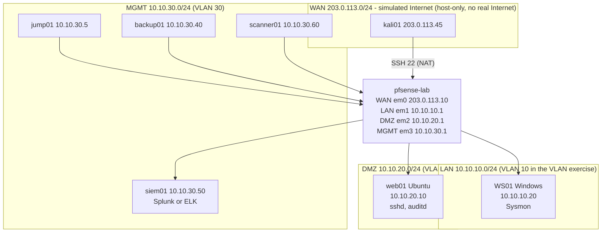

# Lab architecture

> **Status:** a design. No pfSense machine was built for this repository (see the README). Everything below is what you build in Path B.

## Goals

* A **default-deny** firewall between four zones, so that every allowed flow is a deliberate decision that can be explained.
* One **deliberately exposed service** (SSH on the DMZ web server through a port forward) to produce realistic attack traffic.
* A **SIEM in a separate management zone** that receives firewall, Linux and Windows logs.
* Everything inside **isolated virtual networks**: no bridge to your home network, no port forward on your real router, no public scanning.

## Topology

| Zone | Network | pfSense interface | Purpose | Trust |
|---|---|---|---|---|
| WAN (simulated Internet) | `203.0.113.0/24` | `em0` | The "outside". Holds the attacker/test machine | Untrusted |
| LAN | `10.10.10.0/24` | `em1` | User workstations (WS01) | Trusted, but protected from the DMZ |
| DMZ | `10.10.20.0/24` | `em2` | Servers reachable from outside (web01) | Semi-trusted: assumed to be attackable |
| MGMT | `10.10.30.0/24` | `em3` | SIEM, jump host, backup server, scanner | Trusted, restricted |

Interface names `em0`-`em3` are what FreeBSD calls Intel e1000 adapters, the default in VMware Workstation. With another NIC type (for example virtio) they
are named `vtnet0`-`vtnet3`; use your names consistently.

## Why these choices

| Decision | Reason |
|---|---|
| WAN uses `203.0.113.0/24` instead of a private range | It is reserved for documentation (RFC 5737), so it can never collide with a real network; the lab's WAN is an isolated segment anyway. pfSense's default "Block private networks" option on the WAN does not apply, but "Block bogon networks" might block it: see the setup guide |
| One virtual network per zone | Works on every hypervisor. VLAN tagging is offered as an optional exercise because it depends on the virtual switch |
| DMZ cannot start connections to the LAN | The classic reason for a DMZ: a compromised server must not reach the workstations |
| LAN cannot reach MGMT | Workstations have no business on the SIEM or jump host |
| Port 22 forwarded to web01 | A realistic exposed service that produces brute-force traffic in all three log sources |
| Logs sent to a separate zone | An attacker who controls a server cannot easily erase logs that are already on the SIEM |

## Machines

| VM | Role | OS | Suggested resources | Address |
|---|---|---|---|---|
| pfsense-lab | Firewall | pfSense CE | 1 vCPU, 1 GB RAM, 8 GB disk, 4 network adapters | see above |
| WS01 | Windows client | Windows 10/11 (evaluation image) | 2 vCPU, 4 GB RAM | `10.10.10.20` |
| web01 | Linux server | Ubuntu Server LTS | 1 vCPU, 1-2 GB RAM | `10.10.20.10` |
| kali01 | Test/attacker machine | Kali Linux | 2 vCPU, 2-4 GB RAM | `203.0.113.45` |
| siem01 | SIEM | Ubuntu with Splunk or ELK | 2-4 vCPU, 6-8 GB RAM | `10.10.30.50` |
| jump01 (optional) | Administrator host | any Linux | small | `10.10.30.5` |

These sizes are suggestions, not measured requirements.

## How this connects to the other projects

The same fictional incident is described by three logs that must agree:

| Evidence | Where | What it shows |
|---|---|---|
| Firewall log (this repository) | `samples/filterlog_sample.log` | The Internet scan is blocked; SSH through the NAT is allowed; DMZ-to-LAN is blocked; WS01 reaches `203.0.113.45:443` |
| Linux logs | SOC lab and log-analysis projects | The SSH login attempts, with the same source ports as the firewall log |
| Sysmon | SOC lab project | The connections from WS01, with the same source ports |

You can follow one connection across the sources by its **source port**; see `docs/log-analysis.md`.
